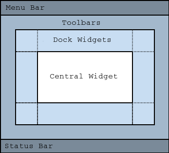

# Intro

* `oopLecture.py` runs a GUI Window written in PyQt6. The Window contains a QTreeWidget that controls the flow of the lecture
* While it is resource intensive, the demonstration is intended to be used with PyCharm because:
  * PyCharm has many features that are useful for formatting Python
  * PyCharm has useful autocomplete features like creating properties of classes to properly access Protected Attributes
* Selecting an item under any of the lesson sections will write a string to the `oopDemo.py` file
  * Display `oopDemo.py` in an IDE or Text Editor that will easily update when the file is changed
* The string will also be written to a unique file in `scripts/` to share with the attendees and include a comment with the notes for each script
* Selecting an item will update `place.json` to keep track of lesson progress should more than one session be needed
* Reset the lecture progress by going to `File > Reset Lecture` or by hitting `Ctrl+r`
* If you are using an IDE to run and display code for the course, and your IDE does not allow you to run two scripts at the same time:
  * Create an exe file of `oopLecture.py` using the `create-app.py` file that runs on PyInstaller
  * PyInstaller is sensitive to Python version, so you might need to add hidden imports to use it
* A script for the lecture is shown below
  * This script will refer to the corresponding code
  * Read through this while you use `oopLecture.py` to rewrite `oopDemo.py`

# Section 0: "How to set up a Class"

### 0.0: Basic Class

* Let's set up the most simple Class we can
* This class does nothing and has no information associated with it
* How do we initialize an Object (or Instance) of this Class?

### 0.1: Initialize an Object

* All we have to do in Python is call this class as shown
* Here is a built-in function that can be useful:
  * `isinstance(<var>, <class>)` will return a boolean value if a given variable is an instance of the given class
* We can see that `isinstance()` returns `True` so `a` is an instance of our class `ExampleA`
* Now that we know how the basics of using a class, let's make them actually do something

# Section 1: "Class Attributes"

### 1.0: Create a Class Attribute

* Here is how we create a Class Attribute
  * Looks almost exactly the same as creating a variable
* Now `x` is an Attribute of the Class `ExampleA`
* How can our main script access `x`?

### 1.1: Accessing Class Attributes

* We have two ways of accessing Class Attributes:
  * We can access it by `<class name>.<attribute name>`
  * Or we can create an instance of the class and access it by `<instance variable>.<attribute name>`
* A very important aspect of Object-Oriented Programming in Python is understanding how Python is managing memory
  * Let's see how Python is allocating memory for these objects

### 1.2: Memory Allocation 1

* Python has this interesting built in `id()` function
* This function returns the memory address of whatever is passed to it

POLL: True or False: An instance of this class has the same memory address
as the class itself
<ol type="a">
<li>True</li>
<li>False</li>
</ol>

<details>
<summary>Correct Answer</summary>
B. False

Explanation: The class will have a location in memory, but it is essentially acting as a blueprint to create unique instances
</details>

### 1.3: Memory Allocation 2

* What about the memory address of the `x` attribute of this instance and directly accessing the `x` attribute?

POLL: True or False: The `x` attribute of the object and the class will have the same memory address
<ol type="a">
<li>True</li>
<li>False</li>
</ol>

<details>
<summary>Correct Answer</summary>
A. True

Explanation: the attribute has a different memory address than the class and the object, and it has not changed
</details>

### 1.4: Memory Allocation 3

* Now what will happen if I change the value of `x` for the instance of `ExampleA`?

POLL: True or False: Changing the value of the `x` attribute will change the memory address of the attribute
<ol type="a">
<li>True</li>
<li>False</li>
</ol>

<details>
<summary>Correct Answer</summary>
B. False

Explanation: A memory location won't hold two sets of information, so it must move to a different memory location to hold the new value of `a.x`
</details>

### 1.5: Memory Allocation 4

* What happens if I set `a.x` to a value, but it is the same value as the default in the class?

POLL: True or False: Setting the `x` attribute to its original value will not change the memory address
<ol type="a">
<li>True</li>
<li>False</li>
</ol>

<details>
<summary>Correct Answer</summary>
A. True

Explanation: The value of the attribute does not change so Python will not change the memory address of the attribute
</details>

### 1.6: Memory Allocation 5

* What happens if we set `a.x` to a different value and the set it back to the original value?

POLL: True or False: Setting the attribute back to the original value will restore its original memory address
<ol type="a">
<li>True</li>
<li>False</li>
</ol>

<details>
<summary>Correct Answer</summary>
A. True

Explanation: There is already a location in memory for the original value of `a.x` so Python will return it to the same address
</details>

### 1.7: Private and Protected Attributes

* If we want to create a Protected Attribute in Python we can add a single `_` prefix to the attribute name
* We can still access this outside of the class but PyCharm does not like letting us do this
* We can let PyCharm add a new method with a `property` decorator that returns the value of the protected attribute
  * Now we are still getting the value of the `x` attribute, but we are not accessing the protected attribute directly
  * This seems like a lot of extra work to add a seemingly unnecessary workaround, but this allows us to adhere to the Encapsulation Principle of Object-Oriented Programming
* To make a Private Attribute we simply add a `__` prefix to the attribute name
  * We can not access this attribute at all when our scope is outside the class
  * Now we can set the visibility of our information and choose what we share outside the scope of the object following the Principle of Encapsulation
* We will get into the differences between Private and Protected attributes in the `Parents and Children` section

# Section 2: "Methods"

Attributes are analogous to variables, and Methods are analogous to functions. Methods are special in that they have access to all attributes and other methods of the same class

### 2.0: Define a Method

* Here we see how to define a method
* As I just mentioned, methods are analogous to functions and they are defined with a very similar syntax
* The key aspect to remember for methods is that you still have to pass this `self` argument
* This is the first time we have seen `self` so far, and it is very important for OOP in Python
  * `self` is how an object refers to...itself within the class
  * Passing `self` to a method may seem somewhat redundant but doing so is what gives the method access to all attributes and other methods of the class
* How do we access/run a method of a class?

### 2.1: Run a Method

* If we are going to run a method we first have to create an instance of the class
* Then we run it with the syntax `<instance name>.<method name>()`
* What can we do with methods?

### 2.2: Methods Operation 1

* We can use methods to modify attributes of the object like this

### 2.3: Methods Operation 2

* We can pass outside values into a method

### 2.4: Methods Operation 3

* Methods can call other methods of the class

### 2.5: Methods Operation 4

* Methods can also return values outside the class
* This is another way that Objects interact with each other and also another way to access attributes, _even private and protected attributes_

### 2.6: Static Methods

* Static methods are a special kind of method that do not have access to the class attributes and other methods but still belong to the class
* Notice that we no longer pass `self` as an argument into the method
  * This is why we pass it to other methods even though it seems redundant
* One interesting aspect of static methods is that we can access them without creating an instance of the class

### 2.7: Assigning New Methods

* You can assign outside functions or methods to an attribute like this
* Also notice that doing this does not change the memory address of the function

### 2.8: Private and Protected Methods

* Using the same syntax as private and protected attributes, we can create private and protected methods with the `_` and `__` prefix convention
* Notice that both attributes here are Private Attributes
* We can run a protected method from outside the class with no issue, but PyCharm is here to let us know that it is a protected method, and we should not do that
* Similarly to private attributes, we do not have access to private methods outside the class
* However, we can create a public method that can be accessed outside the class and has access to all protected and private information of the class
* Remember back to the `Abstraction` Principle of Object-Oriented Programming
  * We create Public methods that allow interaction with our object, but we hide the internal mechanisms of the object that we want to remain hidden

# Section 3: "`__init__()` and Instance Attributes"

Now that we know how to create Class Attributes and Methods, we can get into the real nitty-gritty of classes; starting with a special method named `__init__()`

### 3.0: `__init__()` 1

* Here is what it will look like when we define `__init__()`
* It does not look any different from any other method except for the double underscores
* We still pass `self` as the first argument
* So how do we run this `__init__()` method?

### 3.1: `__init__()` 2

* Turns out we don't have to worry about it!
* When we _initialize_ an object, Python will run the `__init__()` method automatically
* But when does Python run `__init__()`?

### 3.2: `__init__()` 3

* After all Class Attributes and other methods have been initialized too
* `__init__()` can still access the `x` attribute even though it is defined above `x`
* All methods and class attributes will be compiled during the initialization process before `__init__()` is executed
* All this time I have been saying _Class_ attribute because there is another type of attribute called the Instance Attribute

### 3.3: Instance Attributes

* Here we are defining another attribute `y` in the `__init__()` method
* They are accessed the same way as class attributes
* What makes Instance Attributes different from Class Attributes?
  * For starters, we _have_ to create an instance of this class to access the attribute
  * We can not run this commented out line because `y` is an _Instance_ attribute
* Let's see what else we can do with the `__init__()` method

### 3.4: `__init__()` 4

* If we want to initialize an object with a value we can pass it into `__init__()` like this
* Since we never directly call the `__init__()` method, this is how Python handles these passed values
* This is another key difference between Instance and Class Attributes
  * Class Attributes will be the same for all objects initialized from the class, unless intentionally changed
  * Instance Attributes do not necessarily have to be the same

### 3.5: `__init__()` 5

* Like other methods, `__init__()` can call other methods
* If the class I am writing has many attributes or needs to perform many actions during construction, I like to move some initialization procedure to other methods for readability

### 3.6: `__init__()` 6

* A note on best practices
* All attributes that the class will use should be in `__init__()` so that a new reader knows all attribute of the class from only inspecting `__init__()`
* This also contributes to better usability
  * If an attribute only gets defined in another method, and we forget to call that method then it will not exist
  * PyCharm will not give us any error except for telling us that `self.x` should be added to `__init__()`

### 3.7: More Memory Allocation 1

* What happens when we change an attribute of this instance; will the memory address change?

POLL: True or False: Changing the value of an Instance Attribute will _not_ change the memory address of the object
<ol type="a">
<li>True</li>
<li>False</li>
</ol>

<details>
<summary>Correct Answer</summary>
A. True

Explanation: We are only changing an attribute of this object. Python does not need to create an entirely new object in memory just because of this small change so the memory address will remain the same.
</details>

### 3.8: More Memory Allocation 2

* Let's create an instance of a class, and then assign another variable as equal to the first instance
* Do we think that Python is going to run `__init__()` again? Will `a` and `b` have memory address?

POLL: What will the printed output of this script?
<ol type="a">
<li>"Hello World!\nHello World!\nTrue"</li>
<li>"Hello World!\nHello World!\nFalse"</li>
<li>"Hello World!\nTrue"</li>
<li>"Hello World!\nFalse"</li>
</ol>

<details>
<summary>Correct Answer</summary>
C. Hello World!\nTrue

Explanation: Assigning `b` as equal to `a` does not run `__init__()` again, and they will have the same memory address
</details>

### 3.9: More Memory Allocation 3

* What about if we change the `x` attribute of `b`?

POLL: What will the printed output of this script?
<ol type="a">
<li>Hello World!\nHello World!</li>
<li>Hello World!</li>
</ol>

<details>
<summary>Correct Answer</summary>
B. Hello World!

Explanation: Just changing the instance attribute will not run `__init__()` again
</details>

### 3.10: More Memory Allocation 4

* What if we change a Class Attribute instead? Will that run `__init__()` again?

POLL: What will the printed output of this script?
<ol type="a">
<li>Hello World!\nHello World!</li>
<li>Hello World!</li>
</ol>

<details>
<summary>Correct Answer</summary>
B. Hello World!

Explanation: No. Changing any attribute of `b` will not run `__init__()` again
</details>

### 3.11: More Memory Allocation 5

* Let's compare the memory addresses of `a` and `b`
* We create and instance of our class, set `b` equal to `a`, then change `b.x`

POLL: What will the output be?
<ol type="a">
<li>True</li>
<li>False</li>
</ol>

<details>
<summary>Correct Answer</summary>
A. True

What is going on here? We only changed the `x` attribute of `b`, not `a`. And I told you earlier that a memory address is not going to hold two sets of information, so that would mean that `a.x` must be equal to `10`, right?
</details>

### 3.12: More Memory Allocation 6

* It _is_ equal to 10!
  * But we didn't change `a.x` so what is going on?
* It turns out that by declaring `a = ExampleA()` what we are really doing is telling Python:
  * "When I use the variable `a`, I am referring to something at a specific memory address"
* Then, when we say that `b = a`, we are telling Python that `b` refers to the same memory address as `a`
* So if we modify _any_ attribute of either `a` or `b`, we are modifying that attribute in both!
* This can be useful if you understand what is going on and soooooooooo frustrating when you don't and have to learn this on your own
* Now that we understand core fundamentals of classes, let's start looking at some more advanced aspects of OOP

# Section 4: "Subclassing"

### 4.0: Basic Child Class 1

* Here we have defined two classes, `ExampleA` and `ExampleB`
* `ExampleB`  is considered a Child of the Parent class, `ExampleA`
  * This relationship is also referred to as superclass and subclass, or base class and derived class
  * I will also use subclass as a verb; such as `ExampleB` is subclassing `ExampleA`
* We create an instance of `ExampleB` the same as we would any other class, but what is going on with `ExampleB`?

### 4.1: Basic Child Class 2

* We set the variable `b` to be an instance of `ExampleB` so the return of `isinstance()` here will obviously be `True`

### 4.2: Basic Child Class 3

* Is it an instance of `ExampleA` though?

POLL: True or False: `b` is an instance of `ExampleA`
<ol type="a">
<li>True</li>
<li>False</li>
</ol>

<details>
<summary>Correct Answer</summary>
A. True

</details>

### 4.3: Basic Child Class 4

* Are instances of parent classes also instances of their children?

POLL: True or False: `a` is an instance of `ExampleB`
<ol type="a">
<li>True</li>
<li>False</li>
</ol>

<details>
<summary>Correct Answer</summary>
B. False
</details>

### 4.4: Inheritance 1

* Child classes inherit all Class Attributes and methods of their parent
* When we run this script, it will print `5` because `ExampleB` has inherited the `x` class attribute

### 4.5: Inheritance 2

* We do not have an `__init__()` method in `ExampleB` though
* Does `b` have a `y` attribute?

POLL: What will be the output of this script?
<ol type="a">
<li>10</li>
<li><code>AttributeError</code></li>
</ol>

<details>
<summary>Correct Answer</summary>
A. 10

Explanation: `ExampleB` inherits the `__init__()` method from `ExampleA` so it will still run when we create an instance of `ExampleB`
</details>

### 4.6: Inheritance 3

* As mentioned earlier, child classes inherit all methods from their parent so `ExampleB` has the `printX()` and `printY()` methods
* All of this so far is fine, but we still have not done anything with `ExampleB`
  * It is still exactly like `ExampleA` so what is the point of creating a child class?

### 4.7: Child Methods 1

* For starters, we can create new methods in the child class
* In `ExampleB` here we have this `printSumXY()` method that prints the sum of the `x` and `y` attributes

### 4.8: Child Methods 2

* What about if we create an instance of `ExampleA` and run the `printSumXY()` method?

POLL: What will the output of this script be?
<ol type="a">
<li>15</li>
<li><code>AttributeError</code></li>
</ol>

<details>
<summary>Correct Answer</summary>
B. <code>AttributeError</code>

Explanation: Parents do not have access to methods or attributes of the child class
</details>

### 4.9: Protected vs. Private

* Now that we are on Inheritance, we can finally demonstrate the difference between Protected and Private attributes and methods
* Note that we have one protected and one private attribute and method in our parent class
* Our child class only defines one public method
* If we try to run this protected method on an instance of our child class...
  * ...it runs without issue
  * `ExampleB` has inherited the protected methods and attributes and still tracks it as protected
* Now let's run the `print_params` public method of our child class...
  * ...and we see that we get an `AttributeError` trying to access the private method
  * This is the difference between Protected and Private
  * Child classes will still inherit Protected methods but will not inherit Private ones
* If we change the `__printY` method in our parent class to be Protected...
  * Then we see that we can also access the new `_printY` method, and we can even access the Private attribute of our parent class
  * But if we were to try to access the Private attribute directly in the child class with this commented out line in our `print_params` public method...
  * ...then we get an `AttributeError` because the Private Attribute is not accessible directly by the child class
  * If we move the `_printY` method to the child class, we still get the `AttributeError`
  * This is a kind of tricky aspect about inheriting attributes and methods
    * If we are inheriting a method that can access a private method of the parent class that will still work, even though the child class does not have direct access to that attribute

### 4.10: Overriding `__init__()`

* If we want `ExampleB` to have its own `__init__()` method, we are free to do so

POLL: What will the output of this script be?
<ol type="a">
<li>10</li>
<li><code>AttributeError</code></li>
</ol>

<details>
<summary>Correct Answer</summary>
B. <code>AttributeError</code>

Explanation: Here we are _overriding_ the parent method and this is the only aspect of the Polymorphism Principle of Object-Oriented Programming that is implemented by default in Python. Since we have overridden the `__init__()` method, Python will no longer run  the `__init__()` method of `ExampleA` when we create an instance of `ExampleB` unless we do something special.
</details>

### 4.11: `super().__init__()`

* We can access the parent from the child with this `super()` call
* So when we add this `super().__init__()` call to the child `__init__()` method, we are telling Python to run the parent `__init__()` method and then continue with the rest of this `__init__()` method
* Now if we run this script, we see that `b` does have the `y` attribute
* We have seen this `__init__()` method quite a bit now, and you maybe be wondering what is going on with the name of it
  * `__init__()` is only one of a specific kind of methods called `Dunder Methods`

### 4.12 Multilevel Inheritance

* Multilevel Inheritance is kind of like setting up a chain of inheritance with classes
* In this example, `class C` inherits from `class B` which inherits from `class A`
* We can see from the printed output that when we create an instance of `C`, we:
  * Call the `__init__()` method of `B`,
  * which calls the `__init__()` method of `A` before we finish the initialization of `C`
* We also see the our instance of `C` is also an instance of `class B` and `class A` we would expect

### 4.13 Multiple Inheritance

* Child classes can have multiple parents
* For now in this example ignore the `class C`, we will cover that one later
* We see that `class D` inherits from `class A` and `class B`
* When we run this code, we see that has indeed inherited the `printX()` method from `class A` and ran `class A`'s `__init__()` method with the `super()` call
* What if we try to run the `printY()` method from `class B`?

POLL: What will the output of this script be?
<ol type="a">
<li>10</li>
<li><code>AttributeError: 'D' object has no attribute 'printY'</code></li>
<li><code>AttributeError: 'D' object has no attribute 'y'</code></li>
</ol>

<details>
<summary>Correct Answer</summary>
C. <code>AttributeError: 'D' object has no attribute 'y'</code>

Explanation: We inherit the <code>printY()</code> method, but <code>super()</code> only runs the <code>__init__()</code> method of <code>A</code>
</details>

* How can we run the `__init__()` method of `B`? We have to do it manually by adding `B.__init__(self)` to the `__init__()` method of `class D`
* Now if we try to run the `printY` method, we see that `D` does have the attribute `y`
* For a moment, this may not seem like we are truly inheriting from `class B`, but remember that we still inherit the methods of `class B`
  * We can add `C.__init__(self)` and now our `class D` will have access to the `z` attribute, but not the `printZ()` method because we did not inherit from `class C`
* If we also subclass `class C`, then we will have access to the `printZ()` method

# Section 5: "Dunder Methods"

* Dunder methods get their name from the double underscores at the beginning and end of the method name
* There is nothing inherently special about Dunder methods, they get defined the same way as other methods but with a different naming scheme
* The reason they have any importance at all is that many of Python's built-in functions and operators know to call these Dunder methods
* The reason they were given double underscores is to make them more difficult to override
  * You have to go out of your way a bit to be able to override them which makes Python's operation more stable
* So what are some other Dunder methods and how are they used?

### 5.0: `__init__()`

* We've already seen `__init__()` in operation
* Python knows to look for an `__init__()` method when creating an instance of a class

### 5.1: Printing an Object 1

* If we print an Object then we might get something like this
* We see that it is an object of `__main__.ExampleA` and we have the memory address of the object
* This is not really useful for anything though, so why don't we help out `print()`?

### 5.2: Printing an Object 2

* In Python, `print()` is actually calling the `__str__()` Dunder method of the class
* `__str__()` has to return a string, otherwise we will get a `TypeError`
* Now if we run this script, we can get an output that is more informative

### 5.3: Adding Objects 1

* Another common built-in operation is `+`
* The `+` operator calls the `__add__()` Dunder method of the object
* If we tried to add objects together that did not have `__add__()` defined, we would get a `TypeError`

### 5.4: Adding Objects 2

* What if we swap the order of `5` and `a`?

POLL: What is the printed output of this script?
<ol type="a">
<li>10</li>
<li><code>TypeError</code></li>
</ol>

<details>
<summary>Correct Answer</summary>
B. <code>TypeError</code>

Explanation: `5` is not an object so it does not have a `__add__()` method, and we need a different Dunder method when `a` is in the second place
</details>

### 5.5: Adding Objects 3

* This `__radd__()` method is called when we need to add in the reverse direction. For adding two numbers it does not seem necessary but...

### 5.6: Other Dunder Methods

* ...it makes sense for other mathematical operations
* Every basic mathematical operation in Python is controlled by these Dunder Methods
* Even Boolean comparisons are controlled by Dunder methods
* This is not every Dunder method that Python uses
* Now you may have noticed that there is something strange going on here which is that the `__add__()` Dunder method has a `+` in it
  * Is this `+` behaving differently? No it's not. It is calling the `__add__()` method of the `x` attribute
  * But for that to be true, that means that the `x` attribute has to be an instance of some class, right?

# Section 6: "Objects, Objects, Everywhere"

### 6.0: And

* That's exactly what it is
* The `x` attribute is an instance of the `int` class
* Python has this neat built-in `dir()` function
  * This function will return a list of all methods and attributes of the object that is passed to it
  * Now we can see the structure of Python's built-in `int` class

### 6.1: I

* Every time we create a variable, we are creating an instance of a class
* All the data types that you are familiar with like integers, floats, lists, etc. are all classes
* The `isinstance()` function checks if a variable is an instance of a class
* The `type()` function basically just returns the name of the class that the object is initialized from
  * And note that it is also printing out `class` here

### 6.2: Mean

* Just like when we used the `dir()` built-in function on the attribute `x`, we can use it on this variable `x` and see the same attributes and methods of the integer class

### 6.3: Everywhere

* In this script we end up creating three instances of the `int` class
* By adding `x` and `y` together we call the `__add__()` Dunder method of `x`
* And when we print, we are calling the `__str__()` method of the object resulting from the summation
* _Everything_ in Python is an object which means that if anyone asks if you are an Object-Oriented programmer, you can _technically_ say yes because you work with Python
  * They are really asking if you know how to create your own classes and objects, so you should wait until the end of this course, and _then_ you can say yes

### 6.4: Quiz 1

POLL: Not including objects in the base classes, how many unique objects are created by this script?
<ol type="a">
<li>1</li>
<li>2</li>
<li>3</li>
<li>4</li>
</ol>

<details>
<summary>Correct Answer</summary>
C. 3
</details>

### 6.5: Quiz 2

POLL: Not including objects in the base classes, how many unique objects are created by this script?
<ol type="a">
<li>1</li>
<li>2</li>
<li>3</li>
<li>4</li>
</ol>

<details>
<summary>Correct Answer</summary>
B. 2

Explanation: `x` and `y` are both unique objects but because the value of `y` is `0`, `x` and `z` are actually the same object
  * We can add `print(id(x) == id(z))` to verify this
</details>

### 6.6: Quiz 3

POLL: Not including objects in the base classes, how many unique objects are created by this script?
<ol type="a">
<li>1</li>
<li>2</li>
<li>3</li>
<li>4</li>
</ol>

<details>
<summary>Correct Answer</summary>
A. 1

Explanation: `0` is not an object here, and because we are adding `0` to an integer, `y` will be identical to `x`
  * We can add `print(id(x) == id(y))` to verify this
</details>

### 6.7: Quiz 4

POLL: Not including objects in the base classes, how many unique objects are created by this script?
<ol type="a">
<li>1</li>
<li>2</li>
<li>3</li>
<li>4</li>
</ol>

<details>
<summary>Correct Answer</summary>
C. 3

Explanation: 10 is an object
</details>

### 6.8: Quiz 5

POLL: Not including objects in the base classes, how many unique objects are created by this script?
<ol type="a">
<li>1</li>
<li>2</li>
</ol>

<details>
<summary>Correct Answer</summary>
A. 1

Explanation: Even though we initialize two different variables, since they are the same value Python will assign them the same memory address
  * Again, we can check this using `print(id(x) == id(y))`
</details>

### 6.9: Quiz 6

POLL: Not including objects in the base classes, how many unique objects are created by this script?
<ol type="a">
<li>1</li>
<li>2</li>
<li>3</li>
<li>4</li>
</ol>

<details>
<summary>Correct Answer</summary>
C. 3

Explanation: The string is also an object, even though it does not get assigned to a variable
</details>

### 6.10: Quiz 7

POLL: Not including objects in the base classes, how many unique objects are created by this script?
<ol type="a">
<li>3</li>
<li>4</li>
<li>5</li>
<li>6</li>
</ol>

<details>
<summary>Correct Answer</summary>
B. 4

Explanation: This one is tricky because some might not be sure if `aX` and `aY` have different memory addresses in the function scope
  * They do not have unique addresses but even this is not the only trick
  * `Foo` is _also_ an object; it is an instance of the `function` class
    * `print(type(Foo))`
  * Methods are also instances of the `function` class
</details>

# Section 7: "Creating a new array data type"

* Now that we understand how Python is operating at a lower level, we have the power to do some interesting things with classes
* There is a version of Python called MicroPython that is designed for use on microcontrollers
* This is kind of like a lite version of Python because it does not have access to all the existing Python modules
  * Disappointingly, this includes `numpy`
  * As you probably know, `numpy` is very good at mathematical operations on arrays so not having access to this module can be difficult
  * Why don't we create a class that manages a 1D Array and works with the basic mathematical operations in Python?

### 7.0: Lists 1

* Lists would be a good starting point, but they are obviously not exclusive to numbers, so they do not use the mathematical operators for math
* For instance, `+` does not add the elements of this list together, it combines the two lists into one
  * It is functioning like the `extend()` method of the `list` class

### 7.1: Lists 2

* And if we tried to multiply these two lists together we get a `TypeError`
* We can still use lists, but we need to change their behavior when using Python's operators

### 7.2: "array" class 1

* A lot just showed up at once, so let's break this down method by method
* We create a class named `array`
  * We will be using lists to store our numbers, so we could have subclassed `list`, but we would be overriding so much that it would probably hinder us to do that
  * And we would inherit attributes and methods we do not need so we would end up using more memory than we need which is not great on microcontrollers
* In the `__init__()` method we are passing in the `arr` argument, then converting it to a list if required
  * We then iterate through every element in the `arr` argument to make sure it is a number, or else we raise a `TypeError`
  * Then we assign `arr` to an attribute, get its length, and then create a range that we will use in our other methods
* We define the `append` behavior of this `array` class
  * We are only going to be working with one dimensional arrays for the demo so we will add them to the end of the array
  * We could have done 2D arrays but that would just increase the complexity
* We define the `__str__()` method to give ourselves a nice print statement
* We define `__getitem__()` and `__setitem__()` so that we can index into the array and assign new values to specific elements
* Then we have our `__add__()` and `__radd__()` methods, so we can add arrays together
* We _could_ add a type check for `other` to make sure it is compatible, but if it is not compatible Python will already handle that
  * Best to keep our class as light as possible if we are going to use it with a microcontroller

### 7.3: "array" class 2

* But what happens when we try to add an array of zeros to an existing array?
  * `a` and `c` have identical contents, but not the same memory address
* This is because in our `__add__()` and `__radd__()` methods we are creating entirely new instances of our class and then appending values to it
* All of the questions about how Python manages memory has led to this. Do we want our array class to keep `a` and `c` as unique objects?
* I will add the following loop to the script:
```
for i in range(a.len):
    print(id(a[i] == id(c[i])))
```

POLL: True or False: The individual elements of `a` and `c` share the same memory address. (Will this loop print out all `True` or all `False`?)
<ol type="a">
<li>True</li>
<li>False</li>
</ol>

<details>
<summary>Correct Answer</summary>
A. True

Explanation: We change the address of the class overall, but the address of the individual elements remain the same, meaning we are not heavily consuming more memory. Even though <code>a</code> and <code>c</code> have identical elements that share memory, they are still unique arrays and we can manipulate them individually.
</details>

### 7.4: "array" class 3

* With that in mind, I argue that we want to keep them separate
  * If we have separate variables, then we are almost certainly tracking them separately and want to keep them unique
* Here I have used Python's `any()` built-in function to return one array if the other is all zeros
  * It will return `self` if `other` is all zeros, and it will return `other` if `self` is all zeros
* If we return the exact same array, then `c` is not unique from `a`
  * Therefore if we update either, we update both which is not what we want in terms of usability
* Further edits will expand on the previous state, not this one

### 7.5: "array" class 4

* Now that we know how we want to manage memory during our mathematical operations, let's look into improving our usability.
  * Specifically, what if we want to add a single value to every element of our array?
  * Currently we would get an indexing error when trying to index into `other`
* We've already added this '`__getitem__()` Dunder method to our class
* Since this is what Python looks for when indexing, so we know that if the `other` argument passed does not have that method, then it is likely a single value
* Python has another built-in function called `hasattr()` (which also works for methods), so we can use to check if the argument has a specific method

### 7.6: "array" class 5

* We have not taken steps to make sure that we are only adding arrays of the same size
* We can add one more check to see if the lengths are equal, and then we can raise a `SyntaxError` if they are not the same
* That was a lot just to create two methods to add arrays to arrays and arrays to single values...

### 7.7: "array" class 6

* ...luckily the rest follow a similar trend but with minor changes to the ways we check the values of `self` and `other`
* I've also added Type Hints and a Doc-string to make it more user-friendly
* There's 318 lines of code just to control the basic functionality of our array
  * And this is just for 1D Arrays!
  * But now we can easily many Python's built-in operators for this custom class we created

# Section 8: "Miscellaneous"

### 8.0: Inner Classes

* You can define classes that are within the scope of other classes
* Here we have an outer class `Rectangle` and the inner class `Point`
* Each class has their own `__init__()` constructor and `__str__()` method
* We pass a length and width to the `Rectangle` class and it will calculate the locations of its four points
* The inner class can be accessed by the outer class with the `self.` syntax similar to attributes and methods
* We can access the `Point` class outside of the `Rectangle` class with `p = Rectangle.Point(0, 0)`

### 8.1 JSON Serialization

* Object serialization means that we serialize an object to a series of bytes to store for later use
  * In other words, we are saving objects to files
* JSON stands for JavaScript Object Notation and is a popular method of serialization because it saves data to plain text
* Because the data is plain text, it makes it easy to serialize data for use between different programming languages
* JSON is restrictive in the types of data that can be included. You are limited to:
  * Floats
  * Integers
  * Strings
  * Booleans
  * None (or Null)
  * Dictionaries
  * Arrays (in the form of Lists and Tuples)
_(run code, then switch IDE to serialization.json)_
* Some things to note between the dictionary we created and the json file output
  * Some of the data has been transformed into the JavaScript equivalent
    * Booleans are lower case, `None` has become `null`
  * The `7` integer key we used in our dictionary is now a string
    * Keep that in mind if you are ever using loop variables as keys
  * The tuple that we assigned to `7` is now square brackets, just like "g"
_(switch IDE to oopDemo-b.py)_
* Let's see what happens when we load in this serialized JSON data
  * Notice that we have to use a string of `7` for that key now
  * The tuple that we created has been transformed to a list
    * Tuples are "immutable" meaning that they cannot be edited once created
    * We lost that immutability when we serialized to json
  * `data` is a dictionary type
    * There is no `json` data type, it is just a serialization protocol
    * `data` is a dictionary because that is what we created, json will also load to a list or one of the other data types depending on the file contents
      * Strings must be defined inside of `""` in order for JSON to read them

### 8.2 Pickle Serialization

* `pickle` is another serializatin module and this one is exclusive to Python
* When you pickle vegetables, you process them and store them for later user
  * That is where this module gets its name
* Because `pickle` is Python-exclusive, you can serialize more than just the data types available to json
  * You can even serialize objects from custom classes!
* Here I have created a class with a similar structure as the dictionary in the JSON Serialization example
  * I have included a method that will print the `a` attribute
* The serialization process looks very similar to the process for json serialization
  * Now we include a `b` when we write though because we are writing in binary
* Some items to note with pickle serialization
  _(open serialization.p in Notepad or another text editor)_
  * The output is not in a human readable format
    * We can see some words but overall we can derive nothing meaningful from this
  _(switch IDE to oopDemo-b.py)_
  * We can unpickle the file, and we still have access to the method defined in the class
  * Even though we do not have an explicit call to the class, we still need to include it in our imports
    * If I comment out the import line, and run the pickling of the class again, the unpickle will fail
    * If I did not run the pickling again it would have loaded without issue because of information included in `__pycache__/`
* Be careful to only unpickle data that you know is safe
  * Someone could easily pickle malicious code
* As of Python 3.8.2, `pickle` is faster than `JSON`

# Section 9: "PyQt6"

PyQt is a wrapper for the C++ Qt Framework. It allows users to create visually-appealing, powerful GUI Applications. Guides for PyQt almost exclusively use Object-Oriented Programming.

### 9.0: Create an Application

To create a very basic GUI Application we must include the lines:

```
app = QApplication(sys.argv)

sys.exit(app.exec())
```

to create an application and establish program exit procedures. Between these two lines we can initialize our program.

We create the program by subclassing `QMainWindow`:

```
class Main(QMainWindow):

    def __init__(self):
        super().__init__()
```

This program will open an empty window.

### 9.1: Add a Widget

The Qt Documentation illustrates the layout of `QMainWindow` as:

[](https://doc.qt.io/qtforpython/PySide6/QtWidgets/QMainWindow.html#qt-main-window-framework)

We will not cover all elements of `QMainWindow` in this demo; only `Central Widget` and `Menu Bar`.

We start off setting the title of the window with:

```
self.setWindowTitle('Qt Demo')
```

We then create the `Central Widget` and set the layout of the `Central Widget` with:

```
widget = QWidget()
self.setCentralWidget(widget)
layout = QGridLayout()
widget.setLayout(layout)
```

Now we can add a label to the layout with:

```
self.lbl = QLabel('Hello World!')
layout.addWidget(self.lbl)
```

### 9.2: Connect Button Signals

Qt works on the ideas of signals, not commands. In Tkinter when you program a button, you set the function to run when the user clicks the button. In Qt each element has different signals associated with it, and we can connect these signals to as many operations as we wish.

In this demo we created two labels, and we link two different signals of the same button to update each one.

We see that when we first click the button the label on the left will increment, and when we release the button the label on the right will increment.

### 9.3: Long Running Task 1

Signals can be disconnected too. In this script we release our previously linked signal with the `released` command. We then link to another method that will continuously count and update our label. The method will first disconnect the signal to itself and then connect the signal to the `stopCounting` method.

This Window freezes though and we do not see anything being updated, but we are still printing out what the numbers should be set to, so what is going on?

GUI Windows are very sensitive to thread management. The program itself is operating on the _main_ thread and any time we click a button or run a function/method, that is _also_ running on the main thread. This means that every operation we are doing is blocking our main thread from managing our GUI. If the main thread is blocked for long enough, then the GUI window appears to be frozen.

Any long running operation needs to be transferred to a different thread. Qt has its own threading module that we can use to do this.

### 9.4: Long Running Task 2

First we create a class in a script that is completely separate from any Qt Code. You could set this up in the same script, especially for something this simple, but in general this makes testing easier before implementing into the main code.

We create the `self.counter` attribute rather than use a local variable because we know that we will need to access this information later in our main code.

The `while` loop will be an infinite loop because we have not put in a mechanism to change the value of `self.counting` but that will change when we implement into the main code.

### 9.5: Long Running Task 3

To implement this class into our main program we first have to edit our class that will run our long operation. We set it to subclass `QObject`, then create signals for this class that we will use to communicate with and send information to our main thread. We give an `int` type when we set up the `progress` signal so that we know we will be sending integers to our main thread with the `progress` signal.

In our `startCounting` method, we still change our configuration to the button signals. From there we establish our long running task.

We assign an attribute to an instance of our new class, and we create a separate thread to run it on using `QThread`, and then move the worker class to the new thread.

```
self.worker = longTask()
self.thread = QThread(self)
self.worker.moveToThread(self.thread)
```

We then link the signals for our operation. We link the `started` signal of our thread to the `count` method of our worker. When the worker emits the `finished` signal we need to `quit` the thread and delete both the thread and the worker. We also link the `progress` signal to a new method we named `updateLbl()` in our main class.

```
self.thread.started.connect(self.worker.count)
self.worker.finished.connect(self.thread.quit)
self.worker.finished.connect(self.worker.deleteLater)
self.worker.finished.connect(self.thread.deleteLater)
self.worker.progress.connect(self.updateLbl)
```

`updateLbl()` will set the text of our label to the integer value it receives from our worker

```
def updateLbl(self, msg):
    self.lbl.setText(str(msg))
```

Errors that occur in other threads will not be made available to the user. Here we have this `print(x)` command in our long running task where `x` is undefined. If I run this code, we will not receive an error message. We have to make sure we catch all exceptions, and then transfer them to the main thread.

### 9.6: Emit Signals to Main Thread

Under `if __name__ == '__main__'`, we create a function and override the default `excepthook` method of the `sys` module. This function will directly pass our error directly to the `__excepthook__` Dunder method of `sys`. It will then close our main window.

```
def except_hook(exc_type, exc_value, tb):
    sys.__excepthook__(exc_type, exc_value, tb)
    main.close()
    sys.exit(1)
sys.excepthook = except_hook
```

We add a new method in our class `longTask` that will run our long task and catch exceptions and send them to the main thread in a tuple.

```
def run(self):
    try:
        self.count()
    except:
        self.error.emit(sys.exc_info())
```

In our main class we create a new `staticmethod` that will send our error to our `except_hook` function that we created.

### 9.7: Other GUI Elements

Here is a GUI Window that shows how to implement many common features used in Qt development.

We still have our `longTask` class implemented the same way that we did in the previous code snippet.

Here I have added the following:
* A tab widget with the following tabs
    * An image embedded in the tab
    * A label displaying text
* A dropdown menu with place holder text
* A widget for user text input with place holder text
* A check box
* Two radio buttons
    * Note that we do not need to give any command for Qt to know that only one of these radio buttons can be selected at a time
* A menu bar filled with:
    * Three actions that do nothing
    * A sub menu with an action that prints the text in the user input line
        * This also has a keyboard shortcut that is implemented with only one line

You can see how Qt manages threads by starting the long, counting task and then using the input line and the `Ctll+p` command to print out the text without the operations delaying each other.

### 9.8: Subclassing GUI Elements

This creates the same GUI Window as `qt-demo-7`, but creates subclasses for many of the GUI elements rather than setting their properties in the `__init__()` constructor. This is to further illustrate the interaction of these GUI Elements as objects. It also increases readability of the `__init__()` constructor of `class Main`.
