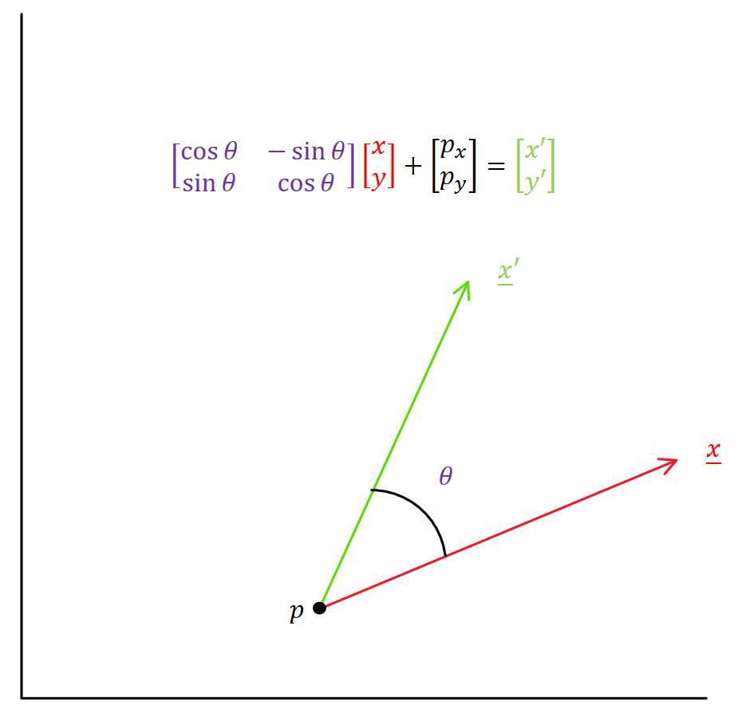

# Background

Characters in digital animation are the combination of complex components on which animators can spend hundreds of hours of work. A key aspect of character animation is the Rigging of the character (essentially a minimalized  version of a skeleton) This below image from MakeHuman shows how a human face can be rigged and how each point/line affects the character animation rendering.

To create an animation for a character, you must manipulate the rigging and specify the position of all points in the rigging at key times. [Mixamo](https://www.mixamo.com/#/) has some great animations available for Adobe Software.

On [Mixamo](https://www.mixamo.com/#/), we can select any animation and watch it with some form of character skin applied. We can select the `Enable Skeleton View` option to see how the Rigging is manipulated to create an animation.

# Project Outline

To illustrate the Principles of Object-Oriented Programming, we will be animating Stick Figures with highly reduced complexity compared to traditional animation software. This will be done using both a Procedural Approach and an Object-Oriented Approach.

# Part 1 - Procedural Approach

Using the provided module and example, students will create their own Stick Figure Animation Scene with the following:
* At least three characters each with their own unique animation
  * Can not use the rotating forearms from the example
  * In the example there are two unique animations: left forearm rotating, right forearm rotating
* Resulting video must be at least 15 seconds long

Students should feel welcome to use loops, if-else statements, and new functions to simplify their code; but they must _**NOT**_ make any changes to the arguments or outputs of the provided functions. They are set up specifically to better illustrate the difference in approach to Procedural and Object-Oriented Programming.

To receive credit for the assignment, students should send their _code_ to the instructor. If only a video or image are sent, no credit will be received.

If students create new functions, do not place them in the `stickProcedural` file. Students should put the functions in their scene script. Grading will be performed with the Instructor's version of `stickProcedural`.

### Procedural Module Explanation

The `stickProcedural` module contains three functions and a video renderer class used to create a stick figure using a Procedural Coding approach.

###### `createCharacter`

This function accepts the `str` `sceneName`, `str` `charName`, and `int` `posx` arguments.

* `sceneName` is the json/avi file name that the character will be included in
* `charName` is the unique name of the character in the scene
* `posx` is the starting `x` position of the character's right foot. Must be greater than 0 and should be less than 1980

The function will create the scene json file if it does not exist and writea connectivity array to the json file under `charName`.

It will return 2-element `NumPy` arrays for each of the character animation points.

###### `rotateLimb`

This function accepts two 2-element `NumPy` arrays and a rotation angle. The first 2-element `NumPy` array acts as the fulcrum and the second array will be rotated around the first by the passed angle, using the mathematics illustrated in the below example:

_We rotate the vector_ <ins>`x`</ins> _by an angle_ `θ`_. We take the result and add the point_ `p` _to get the resulting rotated vector_ <ins>`x'`</ins>.

The function returns the new position of the second 2-element `NumPy` array.

Note that because this only rotates one point around another, if a character is going to, i.e., rotate their entire arm, both arm segments must be rotated individually.

###### `writeTime`

This function accepts the same `sceneName` and `charName` as the `createCharacter` function, the time to write in the scene file, and the individual 2-element `NumPy` arrays that make up the character.

This function will write each of the 2-element `NumPy` arrays to the scene file at the passed time, under the given character name

###### `class Render`

This class is used to create the animation set up by the students. Pass it the `sceneName` and it will create the animation based off the corresponding json file.

It also allows the user to write the first frame of the scene to a jpg file (`write_first_frame`) or display it using `cv2` (`show_first_frame`) to check their scene setup before rendering the scene to video.

###### `exampleSceneProcedural-1`

This script creates a 10-second animation of a single character raising their arm 90 degrees. This is to demonstrate why more key points creates a smoother animation.

In the output video of this script, the character's arm will shorten and then lengthen again to make the rotation. Outputting more key points makes for a smoother animation but requires more effort in the script.

###### `exampleSceneProcedural-2`

This script creates a 7-second animation of two characters waving at each other and will be a smoother animation than `exampleSceneProcedural-1`.

This script is meant to illustrate the procedural nature of procedural code. Students should feel welcome to use loops to simplify their work if they wish to do so. They must take care to properly track their time increment and angle increments for each individual character either way.
