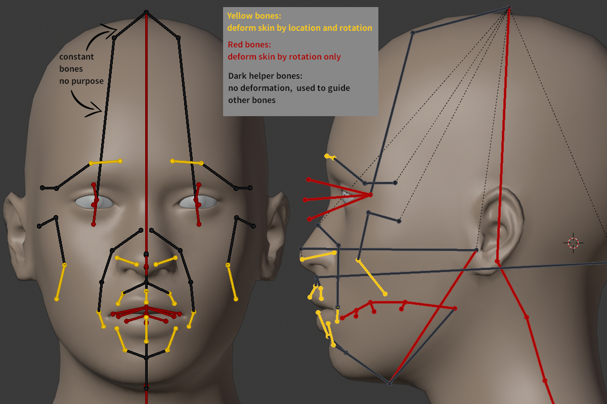

# Background

Characters in digital animation are the combination of complex components on which animators can spend hundreds of hours of work. A key aspect of character animation is the Rigging of the character (essentially a minimalized version of a skeleton) This below image from MakeHuman shows how a human face can be rigged and how each point/line affects the character animation rendering.

To create an animation for a character, you must manipulate the rigging and specify the position of all points in the rigging at key times. [Mixamo](https://www.mixamo.com/#/) has some great animations available for Adobe Software.

On [Mixamo](https://www.mixamo.com/#/), we can select any animation and watch it with some form of character skin applied. We can select the `Enable Skeleton View` option to see how the Rigging is manipulated to create an animation.

# Project Outline

To illustrate the Principles of Object-Oriented Programming, we will be animating Stick Figures with highly reduced complexity compared to traditional animation software. This will be done using both a Procedural Approach and an Object-Oriented Approach.

# Part 2 - OOP Approach

Using the provided module, students should replicate the scene they created in Part 1, but with an  Object-Oriented Programming Approach.

Students should again send their _code_ to the instructor for credit. This includes edits that they made to the `stickObject` module.

Each Character must be a child of the `Person` parent class and contain:
* At least one _private_ method for the character's unique animation
* A unique `__init__()` method as shown in example
* At least one _public_ method for the character's unique animation

The code submission should demonstrate the four Principles of Object-Oriented Programming:
* Encapsulation: already covered in `Person`, no need to add more
* Abstraction: Create private method(s) as shown in example
* Inheritance: Properly subclass from `Person`
* Polymorphism: Override `__init__()` of `Person` as shown in example

### OOP Module Explanation

###### `class Person`

This class creates a stick figure person for the animation. During the object initialization it will write the `sceneName` and `charName` the same as the `createCharacter` function in the `stickProcedural` Module.

Each object will track its own points and keep track of its own time in the animation.

###### `class Jason` and `class Mark`

Example subclasses of `Person`. You can not use these subclasses; they are only for reference when creating your own.

###### `class Render`

This is the same as the `Render` in the `stickProcedural` module.

### `exampleSceneOOP`

This script creates the same 7-second waving animation as `exampleSceneProcedural-2`. Note that it no longer directly manipulates the person, but instead gives an animation to perform and the character moves itself using the Principles of Object-Oriented Programming covered in this course.
